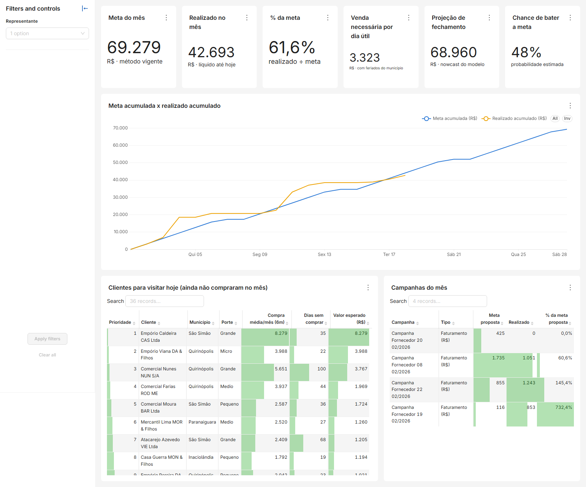
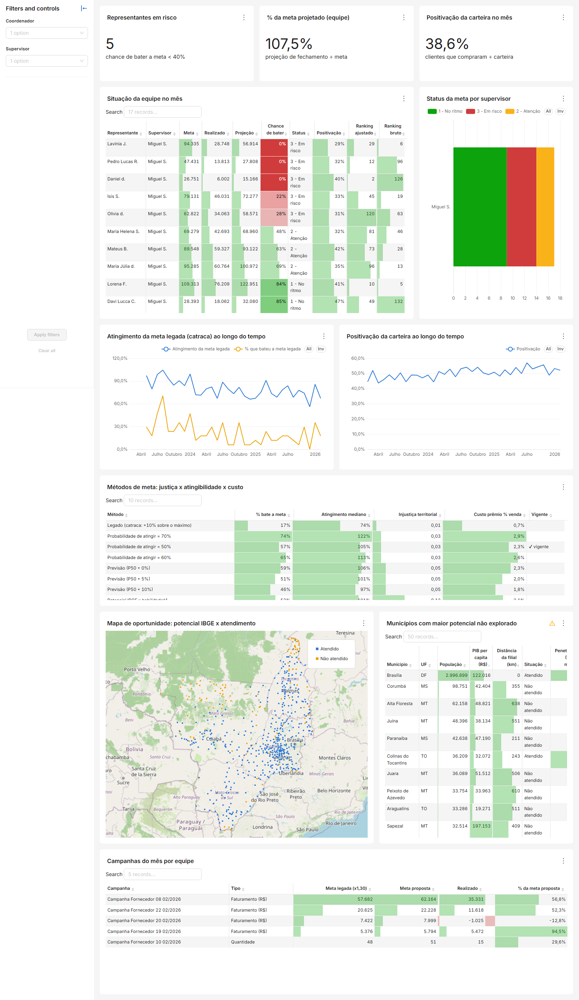
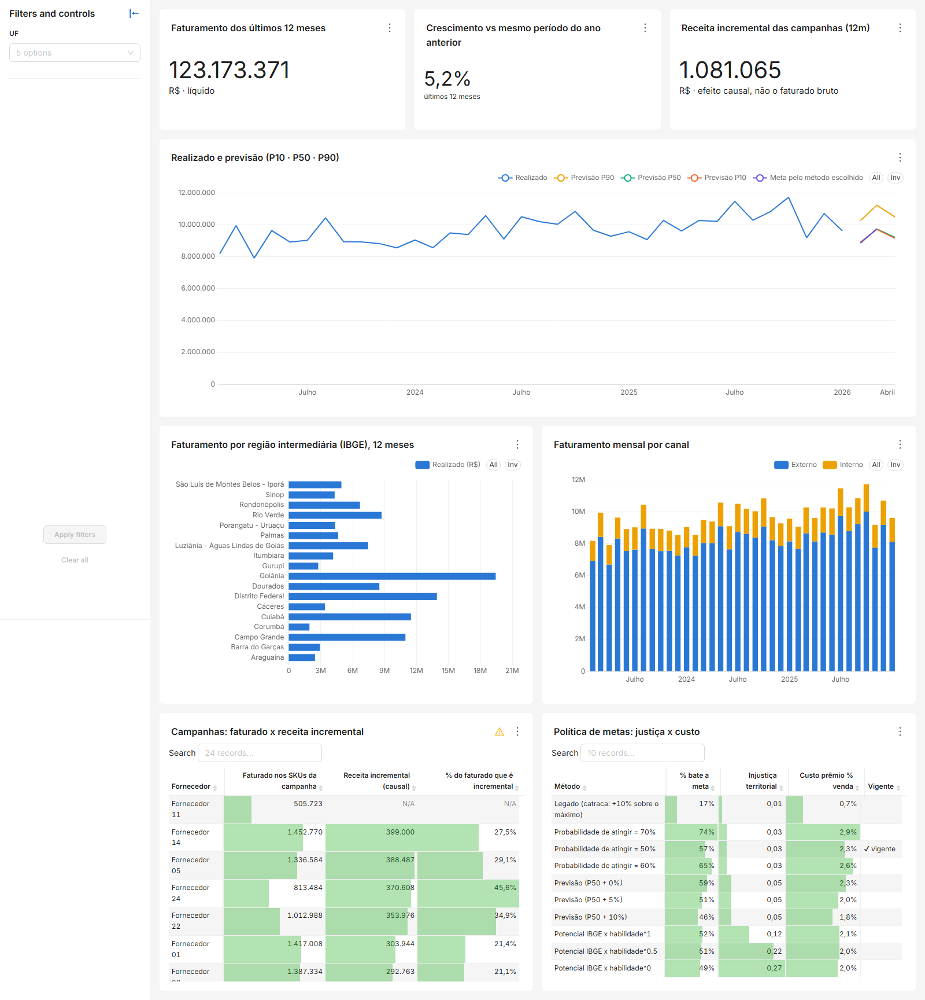
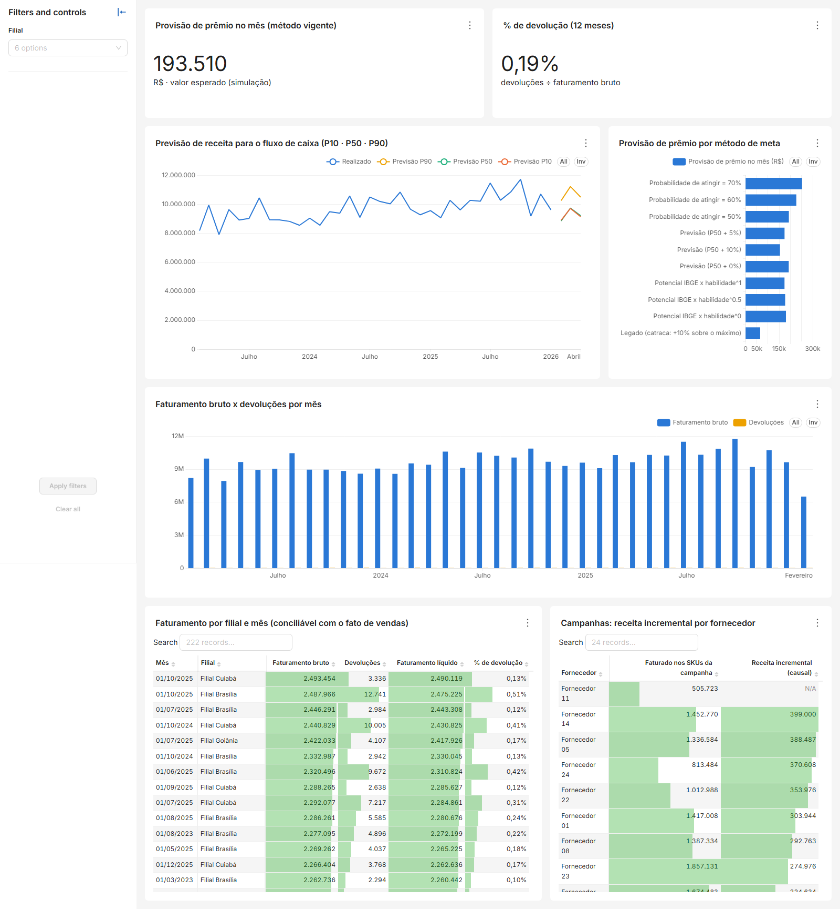
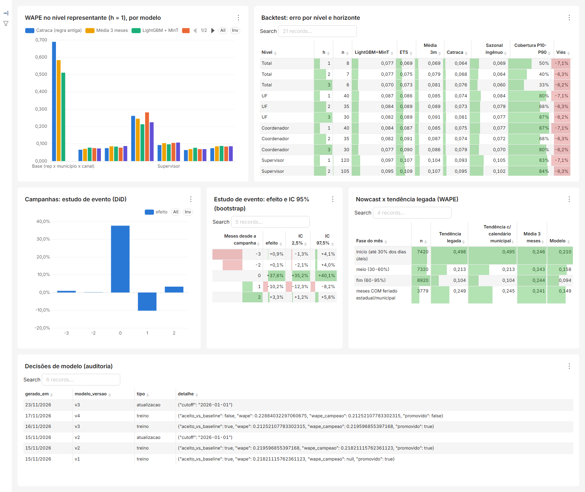
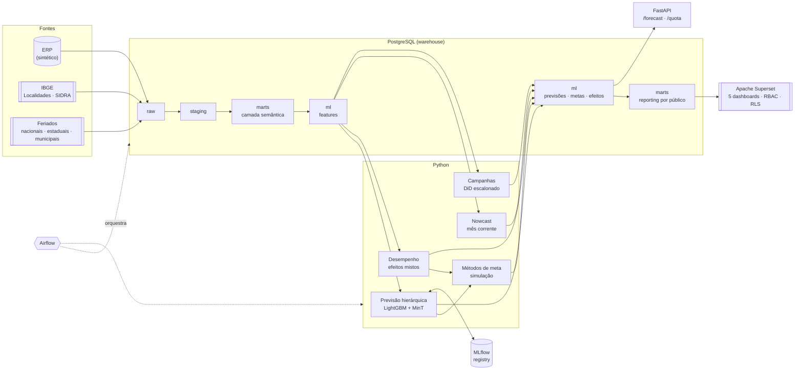
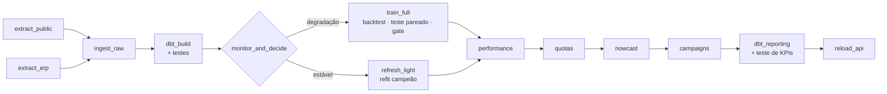

<div align="center">

# 📈 Sales Planning Analytics

### Previsão de vendas, metas justas para a equipe comercial e efeito causal de campanhas: do ERP aos dashboards por público

*Três relatórios de Power BI de uma distribuidora (gestão de vendas, controle dos representantes de vendas e campanhas com fornecedores) reconstruídos como um produto de dados: dados públicos (IBGE e feriados), engenharia de dados, previsão hierárquica, inferência causal, MLOps e BI com permissões por equipe.*


<br>


<br>


[Dashboards por público](#-um-dashboard-para-cada-público) · [Arquitetura](#-arquitetura) · [Dados públicos](#-dados-públicos-ibge-e-feriados) · [Método](#-método-problema--hipótese--método--evidência--decisão) · [Resultados](#-resultados) · [MLOps](#-mlops) · [Como rodar](#-como-rodar-por-partes)

</div>

---

## 🎯 O problema de negócio

Em uma distribuidora, três relatórios conviviam sem integração:

| Relatório original | Para quem | O que mostrava | O que **não** respondia |
|---|---|---|---|
| Faturamento de Vendas | gestão interna | faturado × objetivo × "tendência" (projeção linear) por coordenador, supervisor e representante | A meta é justa? Vamos fechar o mês? |
| Equipe de Vendas | controle dos representantes de vendas | hierarquia, carteira, positivação | Quem performa bem **descontando o tamanho do território**? |
| Campanhas | metas com fornecedores (valor ou quantidade), prêmio para vendedores internos | faturado nos SKUs da campanha × meta | A campanha **gerou** venda ou só antecipou compras? |

As metas eram definidas pelo histórico ("o que vendeu + x%"). Isso cria o **efeito catraca** (Weitzman, 1980): quem supera a meta é punido com uma meta maior, e a equipe passa a maior parte dos meses abaixo de 100%.

1. **Previsão hierárquica** de vendas (empresa → UF → região IBGE → coordenador → supervisor → representante → município), com faixa de incerteza.
2. **Métodos de cálculo de metas** baseados na previsão **e** no desempenho estimado da equipe, comparados por simulação em justiça, atingibilidade e custo do prêmio.
3. **Efeito causal das campanhas** (diferença-em-diferenças), separando venda nova de antecipação.

Organizado em **dashboards**, com permissões por equipe.

---

## 👥 Um dashboard para cada público

Muitas equipes, com objetivos diferentes, leem os mesmos números. O desenho segue os três níveis de painel (operacional, tático e estratégico; Eckerson, 2010; Few, 2006). Há um dashboard por público, todos lendo **a mesma camada semântica** (marts dbt), então um KPI nunca diverge entre painéis. Isso é verificado por um teste automatizado.

| Dashboard | Público | Nível | Perguntas |
|---|---|---|---|
| **Vendas · Minha meta do mês** | representantes e vendedores | operacional, diário | Quanto falta? Quanto vender por dia útil (com os feriados do meu município)? Vou fechar a meta? Quais clientes visitar hoje? |
| **Gestão · Equipe e metas** | coordenadores e supervisores | tático, semanal e mensal | Quem está em risco? Quem performa bem de verdade (ranking ajustado)? Onde há mercado não explorado (IBGE)? Qual método de meta usar? |
| **Diretoria · Resultados e estratégia** | diretoria | estratégico, mensal e trimestral | Vamos bater o ano? Que regiões e canais crescem? Campanhas dão retorno incremental? A política de metas é justa? |
| **Financeiro e Contabilidade** | financeiro e contábil | financeiro, mensal | Receita prevista (P10–P90) para o caixa, provisão de prêmio por método, devoluções por filial |
| **Dados e Modelos** | equipe de dados | monitoramento | O modelo segue melhor que as regras simples? Os intervalos têm a cobertura prometida? |

**Permissões no Apache Superset, provisionadas como código** (`superset/`):
- **RBAC:** cada papel vê só o seu dashboard.
- **RLS:** o representante vê só a própria carteira e o supervisor só a sua equipe.
- Os usuários de demonstração (`rep_demo`, `gestor_demo`, `diretoria_demo`, `financeiro_demo`) são criados automaticamente.

| Vendas (como `rep_demo`) | Gestão (como `gestor_demo`) |
|---|---|
|  |  |
| **Diretoria** | **Financeiro e Contabilidade** |
|  |  |
| **Dados e Modelos** (como `admin`) | |
|  | |

---

## 🏗 Arquitetura



**DAG do Airflow** (`pipelines/dags/sales_planning_analytics_pipeline.py`):



---

## 🌎 Dados públicos: IBGE e feriados

Dados abertos entram no modelo como variáveis e como contexto de negócio:

| Fonte | Uso |
|---|---|
| **IBGE Localidades**: código de 7 dígitos, regiões imediata e intermediária | Chave geográfica e **níveis extras da hierarquia de previsão** |
| **IBGE SIDRA 6579** (população) e **5938** (PIB municipal) | **Índice de mercado** do território: base das metas justas e do mapa de penetração |
| **Feriados nacionais, estaduais e municipais** | **Dias úteis por município**: meta diária, nowcast e variáveis de previsão (feriado, véspera, ponte) |

O relatório antigo só conhecia feriados nacionais. Um feriado municipal tira um dia de venda daquele território, e a meta ignorava isso. Agora a meta diária e a projeção de fechamento usam o calendário **da carteira de cada representante**.

A base aberta de feriados municipais cobre 364 dos 607 municípios da região. Um teste dbt monitora essa lacuna, que está documentada no [data card](docs/data_card.md).

---

## 🔬 Método: Problema → Hipótese → Método → Evidência → Decisão

| Etapa | Previsão | Metas | Campanhas |
|---|---|---|---|
| **Problema** | A "tendência" linear e a regra do histórico erram muito por representante | Metas pelo histórico punem quem supera (catraca) e ignoram o território | Comparar SKUs em campanha com os demais mede seleção, não efeito |
| **Hipótese** | Um modelo global com calendário municipal, reconciliado na hierarquia, erra menos onde as metas são definidas | Metas por previsão + potencial IBGE + desempenho estimado são mais justas | DiD com controles ainda não tratados recupera o efeito |
| **Método** | Origem móvel (8 meses), WAPE/MASE, **bootstrap pareado por série**, conformal | Simulação no backtest: % que bate, dispersão, **correlação com o território**, custo do prêmio | Estudo de evento com placebos; comparação com o **oráculo** do gerador |
| **Decisão** | Aceito só se o IC 95% contra o melhor baseline ficar abaixo de 0 | Política: entre os métodos com 40–70% batendo a meta, o mais justo | Meta de campanha = linha de base × efeito causal do tipo |

Por que estes modelos? O **M5** (Makridakis et al., 2022) mostrou modelos globais de *gradient boosting* superando os estatísticos em vendas de varejo. **MinT** (Wickramasuriya et al., 2019) torna as previsões coerentes entre níveis, de modo que a soma das metas dos representantes é a meta da empresa. O desempenho usa **efeitos mistos com shrinkage** (Efron & Morris, 1975), que não premia a sorte. Detalhes em [docs/model_card.md](docs/model_card.md) e [docs/metas.md](docs/metas.md); referências em [docs/references.md](docs/references.md).

---

## 📊 Resultados

> Os dados são sintéticos, gerados com um **mecanismo causal conhecido**. Por isso dá para medir a distância de cada método até a **verdade** (habilidade real de cada representante, efeito real de cada campanha), o que é impossível com dados reais.

### 1. Previsão: o modelo vence a regra antiga onde as metas são definidas

| WAPE · nível representante · 1 mês à frente | | vs LightGBM+MinT (IC 95%) |
|---|---|---|
| **LightGBM + MinT** | **0,213** | — |
| ETS (melhor baseline) | 0,224 | −1,2 p.p. [−1,7; −0,7] |
| Média 3 meses | 0,245 | −3,2 p.p. [−4,0; −2,5] |
| **Catraca (como as metas eram feitas)** | 0,261 | **−4,9 p.p.** [−5,9; −3,8] |

- Cobertura do intervalo P10–P90: **80%** (alvo: 80%).

**Leitura: o modelo vence onde as metas são definidas, mas não nos níveis agregados.**

| WAPE · 1 mês à frente | Campeão (v3) | Desafiante com alvo diferenciado (v4) | Catraca |
|---|---|---|---|
| Total | 0,077 | **0,057** | 0,064 |
| UF | 0,087 | 0,076 | **0,074** |
| Supervisor | 0,097 | **0,091** | 0,093 |
| **Representante** (critério de aceite) | **0,213** | 0,229 | 0,261 |
| Viés (todos os níveis) | **−7,1%** | +4,1% | |

O campeão tem um **viés de −7%**: árvores de decisão não extrapolam tendência, e a série cresce cerca de 6% ao ano. No representante isso pesa pouco, porque o ruído individual domina o erro. No Total, quase todo o erro é viés, e a Catraca ganha (o `max()` dela compensa a tendência por acaso).

A correção testada foi prever a **variação mensal** em vez do nível (alvo diferenciado). Ela foi escolhida em origens de validação **anteriores** ao backtest. No backtest oficial, melhorou os níveis agregados, mas passou do ponto (viés de +4% a +9% conforme o horizonte) e piorou o representante. O **gate recusou o desafiante** e o campeão segue em produção. Detalhes em [docs/model_card.md](docs/model_card.md#desafiante-recusado-correção-do-viés).

### 2. Nowcast: "vamos fechar o mês?"

| Fase do mês | "Tendência" do Power BI | **Modelo** |
|---|---|---|
| Início (até 30% dos dias úteis) | 0,498 | **0,210** |
| Meio | 0,213 | **0,158** |
| Fim | 0,104 | **0,094** |
| Meses com feriado estadual ou municipal | 0,249 | **0,149** |

### 3. Desempenho: quem é bom de verdade?

| Ranking | Correlação (Spearman) com a habilidade **real** |
|---|---|
| Faturamento bruto (relatório antigo) | 0,44 |
| Venda ÷ potencial do território | 0,51 |
| **Efeitos mistos com shrinkage** | **0,69** |

### 4. Métodos de meta

Simulação nos 8 meses do backtest: cada meta é definida com a informação do fim do mês anterior e confrontada com o realizado.

| Método | % que bate a meta | Alcance mediano | Correlação com o território | Correlação com a **habilidade real** (oráculo) | Custo do prêmio (% da venda) |
|---|---|---|---|---|---|
| **Legado (catraca)** | **17%** | 74% | 0,01 | 0,04 | 0,7% |
| Previsão (P50 + 5%) | 51% | 101% | −0,05 | 0,02 | 2,0% |
| **Probabilidade de atingir = 50%** ✅ | 57% | 105% | −0,03 | −0,01 | 2,3% |
| Potencial IBGE × habilidade⁰ | 49% | 100% | −0,27 | **0,53** | 2,0% |
| Potencial IBGE × habilidade⁰·⁵ | 51% | 101% | −0,22 | 0,36 | 2,0% |

- **A regra antiga fica, em média, 44% acima do que a previsão indica**, e só 17% da equipe bate a meta: é o efeito catraca, medido.
- A política definida **antes** dos resultados (entre 40% e 70% batendo a meta, escolher o mais neutro ao território) escolheu a meta por **probabilidade de atingir = 50%**.
- **Achado:** as metas por previsão são atingíveis e neutras ao território, mas **não premiam habilidade**. A previsão aprende o nível de cada representante, então os melhores recebem metas maiores, uma "catraca disfarçada". As metas por **potencial do território** premiam habilidade (correlação de 0,53 com a verdade), mas herdam o erro de medir o potencial. O caminho natural é um **híbrido**: âncora no potencial IBGE e calibração pela previsão. A discussão completa está em [docs/metas.md](docs/metas.md).

### 5. Campanhas: venda nova ou antecipação?

| | Efeito no mês da campanha | Mês seguinte |
|---|---|---|
| **Verdade (oráculo)** | +37,7% | −12,9% |
| **DiD escalonado** (IC 95%) | **+37,6%** [35,2; 40,1] | **−10,2%** [−12,3; −8,2] |
| Placebos (2 e 3 meses antes) | +0,9% e +0,1% (IC contém 0) ✓ | |
| *Comparação ingênua* (campanha × outros SKUs) | ***−43,9%*** (sinal errado) | |

Como as campanhas vão para itens de giro lento, a comparação ingênua faz parecer que **campanha derruba a venda**. O DiD recupera o efeito real, inclusive a antecipação de compras no mês seguinte (van Heerde et al., 2004). Para planejar as metas de campanha, usamos o efeito agregado por tipo: o erro médio por campanha cai de 0,19 (DiD isolado) e 0,23 (antes × depois) para 0,14.

---

## ⚖️ Quando vale a pena (e quando não)

O modelo de previsão **não vence em tudo**, e a arquitetura não depende disso. O que se ganha em cada frente:

| Frente | Ganho sobre o que existia | Vale a complexidade? |
|---|---|---|
| Previsão por representante | WAPE 0,261 → 0,213 vs catraca; só **−1,2 p.p.** vs ETS | ⚪ Pouco além de um ETS bem feito |
| Previsão no Total / UF | Perde para a catraca (viés de −7%) | ❌ Usar ETS ou correção de nível nesses níveis |
| Nowcast intramensal | Erro no início do mês 0,50 → 0,21 | ✅ Ganho grande, uso diário |
| Métodos de meta | 17% → 57% da equipe batendo a meta | ✅ Muda a política de remuneração |
| Efeito de campanhas (DiD) | Sinal corrigido: −44% (ingênuo) → +38% (real) | ✅ Evita uma decisão errada |
| Ranking de desempenho | Correlação com a habilidade real 0,44 → 0,69 | ✅ |

**Leitura:**

- **A arquitetura se paga pelos produtos, não pelo LightGBM.** O mesmo warehouse (dbt), com os mesmos testes, alimenta nowcast, metas, campanhas e cinco dashboards. Sem ele, cada análise viraria uma planilha isolada.
- **O MLOps já provou seu valor:** o gate recusou o desafiante v4, que pioraria o nível de decisão. Sem registry e gate, ele teria ido para produção.
- **Simplificações possíveis em uma empresa pequena:**
  - ETS no lugar do LightGBM, com perda de cerca de 1 p.p.;
  - cron no lugar do Airflow;
  - sem MLflow, se houver um único modelo e retreino manual.
- **Antes de adotar de verdade:** os dados aqui são sintéticos. Na vida real, o primeiro passo é rodar em **modo sombra** por 3 a 6 meses: o modelo publica as previsões e as metas sugeridas ao lado das oficiais, sem substituí-las, e só depois o gate decide.

---

## ♻️ MLOps

Cada ciclo começa com o **monitor**. Ele compara a previsão publicada no ciclo anterior com o que foi realizado e decide entre **retreino completo** (backtest de 8 origens, gate e registro no MLflow) e **atualização leve** (refit com a configuração campeã). A demonstração abaixo roda três ciclos reais com `scripts/run_local.py`:


| Ciclo | O que o monitor viu | Decisão |
|---|---|---|
| 1 · nov/2025 | Nenhum modelo em produção | Retreino → **v1** promovida (vence os baselines) |
| 2 · fev/2026, choque | WAPE só 4% acima do esperado (razão 1,04), mas **viés de +22,5% no MT** (demais UFs entre −8% e +3%) | Retreino → **v2** promovida (WAPE 0,220 vs 0,218 do campeão, dentro da tolerância de 10%) |
| 3 · fev/2026, normal | Razão de WAPE 0,93, viés do MT +1,4%, cobertura P10–P90 de 80% | Sem retreino: **atualização leve** |
| 4 · fev/2026, normal | (`--force-retrain`) | Retreino → **v3** promovida (0,213 vs 0,220). É o modelo dos resultados e prints deste README. |
| 5 · fev/2026, desafiante | Correção do viés de −7% do campeão (alvo diferenciado) | **v4 recusada**: WAPE 0,229, sem vantagem sobre o ETS (IC 95% de −0,2 a +1,1 p.p.). Produção continua na **v3**. |

O ciclo 5 revelou um defeito no próprio pipeline: um desafiante recusado ainda publicava as previsões dele, e as metas e os dashboards passavam a usar um modelo reprovado. Isso foi corrigido. Hoje um modelo recusado só fica registrado no MLflow (alias `challenger`) e em `ml.model_decisions`, e as métricas dele vão para `reports/challenger_metrics.json`.

O ciclo 2 mostra por que o monitor olha o **viés por UF**, e não só o erro agregado. Uma queda forte numa região quase não muda o WAPE total, mas faz o modelo superestimar sistematicamente as metas daquela região. Os gatilhos são: razão de WAPE > 1,3, viés por UF > 15% ou cobertura dos intervalos < 60%.

- **Champion/challenger** no MLflow Registry. O desafiante precisa vencer o melhor baseline (bootstrap pareado) e não piorar mais de 10% o WAPE do campeão. Todas as decisões ficam em `ml.model_decisions`.
- **Testes de dados no dbt:** chaves e relacionamentos, anti-vazamento (o mês corrente nunca tem alvo), feriado nunca é dia útil, cobertura de feriados municipais (aviso) e **consistência de KPIs entre dashboards**.
- **CI:** lint, testes, o ciclo completo numa amostra contra um Postgres de serviço (inclui o dbt) e o build das imagens.

---

## 🚀 Como rodar (por partes)

A stack usa **profiles do Docker Compose**, para subir só o necessário. Isso ajuda em máquinas com pouca memória.

**Pré-requisitos:** Docker Desktop e `make` (8 GB de RAM recomendados para subir tudo junto).

```bash
git clone https://github.com/mathewsca/sales-planning-analytics.git
cd sales-planning-analytics
cp .env.example .env
make db              # 1) só o PostgreSQL (porta 5433 no host)
make local           # 2) ciclo completo SEM Airflow (gera dados, dbt, modelos, metas, campanhas)
make bi              # 3) Superset em http://localhost:8088 (dashboards, papéis e RLS criados sozinhos)
#    usuários: rep_demo · gestor_demo · diretoria_demo · financeiro_demo (senha: demo1234) · admin/admin

# opcionais
make ml              # MLflow em :5000 (registry de modelos)
make orchestration   # Airflow em :8080 (DAG completa); desligue o BI antes em máquinas com < 8 GB
make api             # FastAPI em :8000/docs
make shock-demo      # demonstração de drift: ciclo em nov/2025, depois fev/2026 com retração no MT
```

Sem Docker, só com um Postgres: `pip install -e ".[api,dbt,dev]"` e `python scripts/run_local.py --no-mlflow`.

---

## 📁 Estrutura

```
├── src/sales_planning_analytics/
│   ├── public/        # extração IBGE + feriados e calendário comercial por município
│   ├── generator/     # mundo sintético com mecanismo causal conhecido
│   ├── ml/            # previsão hierárquica, nowcast, desempenho, monitoramento, treino
│   ├── quotas/        # métodos de meta + simulação
│   ├── campaigns/     # efeito causal (DiD escalonado)
│   └── pipeline.py    # etapas chamadas pelo Airflow
├── dbt/               # staging → marts (camada semântica) → ml → reporting (por público)
├── superset/          # dashboards como código, RBAC e RLS
├── pipelines/dags/    # DAG do Airflow
├── api/               # FastAPI
├── data/public/       # snapshot versionado dos dados públicos
└── docs/              # model card, data card, metas, glossário de KPIs, DAX→SQL, referências
```

---

## 🔒 Privacidade

O projeto parte de um problema de uma empresa real, mas **nenhum dado real está neste repositório**:
- Vendas, equipe, clientes, produtos e campanhas são 100% sintéticos.
- Os IDs são aleatórios e as pessoas com nomes gerados.
- Fornecedores e produtos aparecem só por código fictício.

Os únicos dados reais são **públicos** (IBGE e feriados). Detalhes no [data card](docs/data_card.md).


